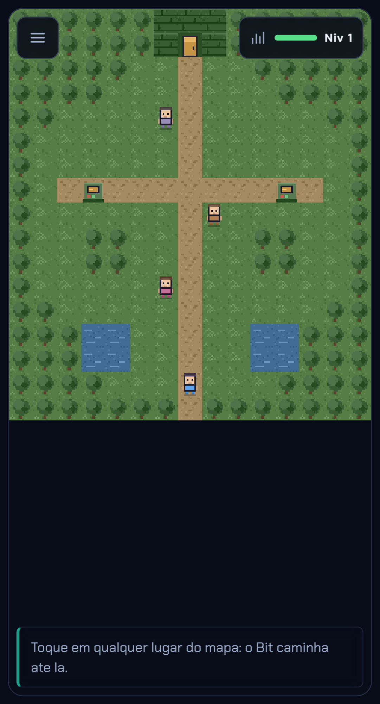
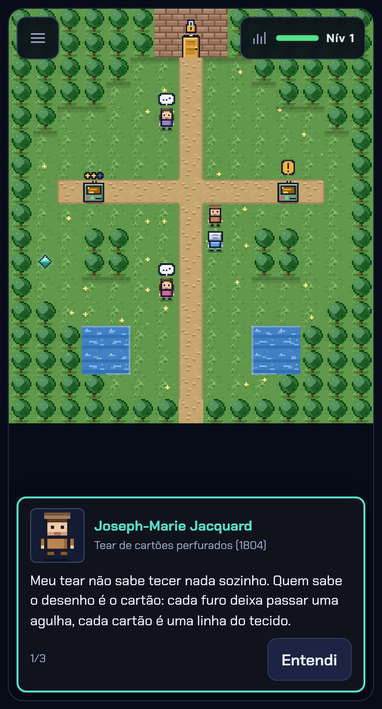
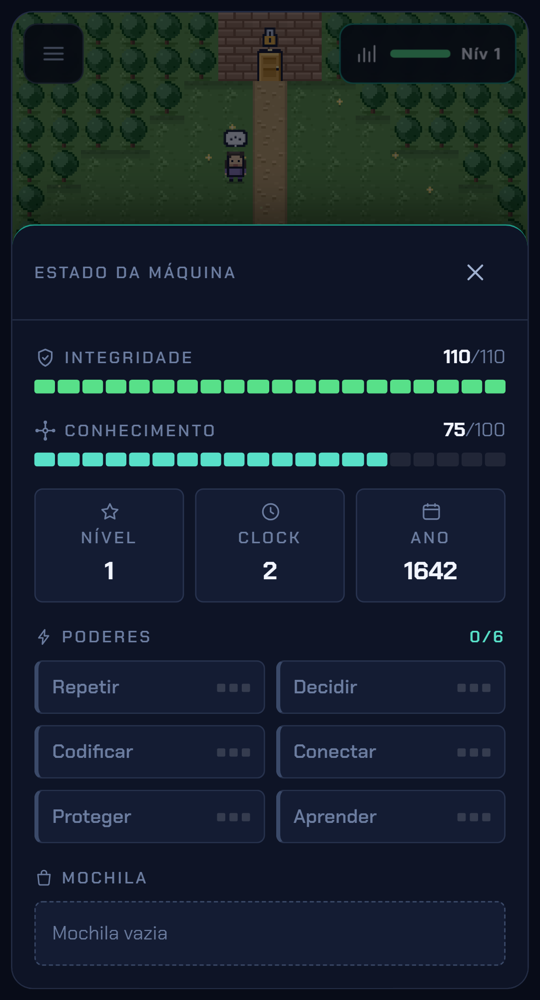

# Da Válvula à IA

**RPG educacional em pixel art sobre a história da computação**, jogado no navegador.

Você controla o **Bit** e atravessa seis eras — uma zona por era. Em cada uma, conversa com
quem fez aquela história, resolve os minijogos dos terminais e passa na prova da era para
ganhar o poder e o item dela, até enfrentar o **BUG Day 0**.

[](https://github.com/SudoMaster7/history-computer/actions/workflows/ci.yml)


Feito como TCC. Mobile-first: celulares de entrada em modo retrato, **100% jogável por toque
simples, sem arrastar**.

<table>
  <tr>
    <td width="33%"></td>
    <td width="33%"></td>
    <td width="33%"></td>
  </tr>
  <tr>
    <td align="center"><sub>O mapa da zona</sub></td>
    <td align="center"><sub>Conversa com uma figura histórica</sub></td>
    <td align="center"><sub>Estado da máquina</sub></td>
  </tr>
</table>

---

## Como se joga

1. **Ande pelo mapa.** Toque numa célula e o Bit caminha até lá sozinho, desviando de árvore e
   água. Não há botão de direção nem arrastar.
2. **Converse com os três personagens da zona.** Cada um conta o que a máquina daquela era é,
   o que ela já consegue fazer e o que ainda não consegue — é esse "ainda não" que prepara a
   era seguinte.
3. **Use os dois terminais.** Cada um abre um minijogo que ensina o poder da era na prática.
   Dentro dele, "O que é isto?" conta qual máquina de verdade aquilo imita e qual
   funcionalidade da era está em jogo, e "Dica" libera ajudas uma a uma — da mais geral à mais
   concreta — sem custo nenhum na pontuação.
4. **Atravesse a porta.** Ela só destranca com as duas missões concluídas, e leva à **prova da
   era**: quatro perguntas, três acertos para passar. Errar não tira vida, e cada resposta vem
   com a explicação — errar também ensina.
5. **Passou?** Ganha o poder da era, o item dela, e a próxima zona abre.

| Era                     | Período   | Poder     | Minijogo            | Item             |
| ----------------------- | --------- | --------- | ------------------- | ---------------- |
| Mecânica                | 1642–1843 | Repetir   | Tear de Engrenagens | Cartão Perfurado |
| Válvulas e Lógica       | 1936–1950 | Decidir   | Circuitos Lógicos   | Válvula Reserva  |
| Transistor e Linguagens | 1950–1970 | Codificar | Mesa de Bits        | Fita Magnética   |
| Redes                   | 1969–1991 | Conectar  | Rota dos Pacotes    | Pacote Roteado   |
| Web, Nuvem e Segurança  | 1991–2010 | Proteger  | Cofre Criptográfico | Chave Pública    |
| Inteligência Artificial | 2012–hoje | Aprender  | Treinar o Detector  | Modelo Treinado  |

---

## Estado do projeto

Nada aqui é promessa: só está marcado como pronto o que já roda.

|                         | Zona, personagens e prova |  Minijogo  |
| ----------------------- | :-----------------------: | :--------: |
| **Mecânica**            |          pronto           | **pronto** |
| **Válvulas e Lógica**   |          pronto           | **pronto** |
| Transistor e Linguagens |          pronto           |   falta    |
| Redes                   |          pronto           |   falta    |
| Web, Nuvem e Segurança  |          pronto           |   falta    |
| Inteligência Artificial |          pronto           |   falta    |
| **Chefão BUG Day 0**    |             —             |   falta    |

Ou seja: **as Eras 1 e 2 fecham o ciclo completo**. Nas outras quatro você anda pelo mapa,
conversa com os personagens e faz a prova, mas os terminais mostram "Terminal em construção".

Também falta: o efeito dos itens de combate (hoje só a Válvula Reserva faz algo), o ranking no
Supabase, o áudio, e o acabamento visual da tela dos minijogos — o mapa e o menu já passaram
por ele, as telas do Tear e dos Circuitos ainda não.

---

## Rodar

Precisa de **Node 22+**.

```bash
git clone https://github.com/SudoMaster7/history-computer.git
cd history-computer
npm install
npm run dev
```

Abre em `http://localhost:5173`. Para ver o jogo como ele foi pensado, use o modo celular do
navegador, em retrato.

<details>
<summary>Todos os comandos</summary>

| Comando                               | O que faz                                                   |
| ------------------------------------- | ----------------------------------------------------------- |
| `npm run dev`                         | servidor de desenvolvimento                                 |
| `npm run build`                       | checagem de tipos + build de produção                       |
| `npm run test`                        | testes de unidade e de contrato (Vitest)                    |
| `npm run test:contract`               | só os testes de contrato (rápido, serve durante o trabalho) |
| `npm run test:e2e`                    | Playwright em Pixel 5, iPhone 12 e desktop                  |
| `npm run ci`                          | tudo que a CI roda                                          |
| `npm run change -- "o que fez"`       | cria a nota da sua iteração                                 |
| `npm run sprites`                     | regenera a pixel art                                        |
| `npm run worlds` / `npcs` / `quizzes` | regenera os dados do jogo                                   |

Para o Playwright, rode antes `npx playwright install chromium webkit`.

</details>

---

## Publicar na Vercel

O repositorio ja vem configurado: a raiz do repositorio **e** a raiz do projeto,
entao nao ha "Root Directory" para ajustar.

1. Em [vercel.com/new](https://vercel.com/new), importe
   `SudoMaster7/history-computer`.
2. A Vercel detecta Vite sozinha. **Nao ha variavel de ambiente para
   configurar** — o jogo roda inteiro no navegador, sem servidor e sem chave.
3. Deploy.

Cada push na `main` publica em producao, e cada pull request ganha uma URL de
previa.

O [`vercel.json`](vercel.json) cuida de tres coisas que quebram um PWA se
ficarem no padrao:

| Caminho                                       | Cache                      | Por que                                                                                 |
| --------------------------------------------- | -------------------------- | --------------------------------------------------------------------------------------- |
| `sw.js`, `manifest.webmanifest`, `index.html` | sem cache, revalida sempre | service worker em cache prende o jogador numa versao velha, e nenhuma atualizacao chega |
| `/assets/*`                                   | 1 ano, imutavel            | tem hash no nome: conteudo novo, nome novo                                              |
| `/sprites/*`, `/fonts/*`                      | 30 dias                    | nao tem hash no nome; quem versiona esses arquivos e o service worker                   |

Tambem traz o redirecionamento de rota unica (qualquer URL cai no
`index.html`) e tres cabecalhos de seguranca basicos.

> **Para testar o que vai ao ar:** `npm run build && npm run preview`. Isso
> serve exatamente o `dist/` que a Vercel publica — e e contra ele que os 54
> testes de ponta a ponta rodam.

---

## Como funciona por dentro

**React + TypeScript + Vite**, PWA instalável. O mapa é **canvas 2D com pixel art 16×16** —
sem WebGL, sem motor de física, sem biblioteca de jogo.

### A regra que sustenta tudo

> `src/core/` e os `logic.ts` dos minijogos **não importam React, canvas, DOM nem rede**.
> Toda regra de jogo é função pura e determinística. Aleatoriedade só por `createRng(seed)`.

Por isso a lógica inteira do jogo é testável sem navegador, e a mesma seed sempre produz o
mesmo resultado. A regra é cobrada pelo ESLint **e** por um teste que lê o código-fonte — então
afrouxar o lint não faz o problema sumir.

### Mapa do repositório

```
src/
  core/         regra pura: rng, rpg, powers, scoring, world, quiz, items, registry
  minigames/    <era>/logic.ts (puro) + Screen.tsx + index.ts + logic.test.ts
  ui/           MainMenu, WorldScreen (mapa em canvas), Quiz, Tutorial, Hud, MissionRunner
  store/        Zustand com persistência em localStorage
  data/         JSON do conteúdo + módulos que o tipam
tools/          geradores de conteúdo e de arte, e os scripts das notas
tests/contract/ o que não pode quebrar
tests/e2e/      Playwright
docs/changes/   uma nota por iteração, com o motivo da mudança
```

Duas regras de organização que valem sempre:

- **Todo número de balanceamento mora em [`src/core/constants.ts`](src/core/constants.ts).**
  Para calibrar o jogo, só esse arquivo muda.
- **Todo texto visível ao jogador mora em `src/data/*.pt-BR.json`.** Identificador de código em
  inglês, texto de jogador em português.

### Como uma zona é desenhada

Em `src/data/worlds.json` o mapa é escrito com caracteres, uma string por linha:

```
.  grama      ,  caminho     T  árvore
~  água       #  parede      _  piso
```

`parseWorld` traduz para a grade de tiles e `findPath` acha o menor caminho em quatro direções
por busca em largura. `validateWorld` recusa zona com terminal fora do mapa ou com qualquer
ponto inalcançável a partir da entrada — e um teste roda isso nas seis zonas exigindo lista
vazia. **Zona quebrada não entra no jogo.**

### A pixel art é gerada por código

Não há asset baixado: [`tools/make-sprites.mjs`](tools/make-sprites.mjs) desenha os tilesets
das seis eras, o Bit (4 direções × 3 quadros) e os 18 personagens, e escreve os PNG usando só
o `zlib` do Node. Rodar de novo produz exatamente os mesmos arquivos.

---

## Mexendo no projeto

Leia **[CONTRIBUINDO.md](CONTRIBUINDO.md)** antes da primeira mudança. O essencial:

```bash
npm run ci                      # lint, tipos, notas, testes com cobertura, build
npm run test:e2e                # Playwright nos 3 dispositivos
npm run change -- "o que fez"   # a nota da sua iteração — obrigatória
```

`tests/contract/` trava o que não pode quebrar:

| Arquivo                | O que trava                                     |
| ---------------------- | ----------------------------------------------- |
| `architecture.test.ts` | o núcleo é puro e determinístico                |
| `api-surface.test.ts`  | os nomes exportados pelo `core/`                |
| `content.test.ts`      | os dados fecham entre si, e a arte existe       |
| `progression.test.ts`  | **o jogo é zerável, sem travar em nenhuma era** |

**Nunca deixe um contrato verde apagando o que ele exigia.** Se o contrato está errado, ele
muda — mas na mesma iteração, com o motivo escrito na nota.

As mesmas regras valem para agentes de IA e estão em [CLAUDE.md](CLAUDE.md), que eles leem
automaticamente.

---

## Documentos

| Arquivo                            | O que tem                                                 |
| ---------------------------------- | --------------------------------------------------------- |
| [CONTRIBUINDO.md](CONTRIBUINDO.md) | o passo a passo de uma iteração e o roteiro de revisão    |
| [DECISIONS.md](DECISIONS.md)       | toda escolha de projeto, numerada, com o motivo           |
| [docs/changes/](docs/changes/)     | uma nota por iteração: o que mudou, por quê, o que quebra |
| [ASSETS.md](ASSETS.md)             | licenças da arte, da fonte e do conteúdo                  |
| [CLAUDE.md](CLAUDE.md)             | as regras para agentes de IA                              |

> **Atenção:** `docs/fases/` guarda o briefing original (F1 a F5). Ele descreve um RPG com hub
> 3D e combate por turnos, que **não é mais o jogo** — a direção mudou duas vezes, e as duas
> estão registradas em `DECISIONS.md` (D11–D16 e D17–D23). Leia o briefing como história do
> projeto, não como especificação.

---

## Licenças

| O quê                                        | Licença                                      |
| -------------------------------------------- | -------------------------------------------- |
| Código                                       | [MIT](LICENSE)                               |
| Conteúdo educacional (falas, provas, textos) | CC BY 4.0                                    |
| Pixel art                                    | autoral, gerada por `tools/make-sprites.mjs` |
| Fonte Chakra Petch                           | SIL Open Font License 1.1                    |

O conteúdo histórico das falas e das provas foi escrito para este projeto a partir de
conhecimento consolidado, mas **ainda não passou por conferência em fonte primária**. Datas e
números (como as 18 mil válvulas do ENIAC) precisam ser checados antes de congelar o escopo —
está registrado em [ASSETS.md](ASSETS.md).
