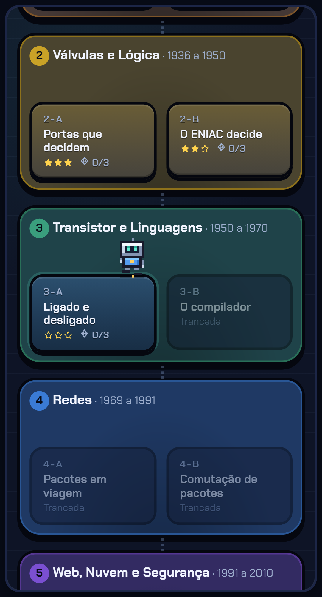
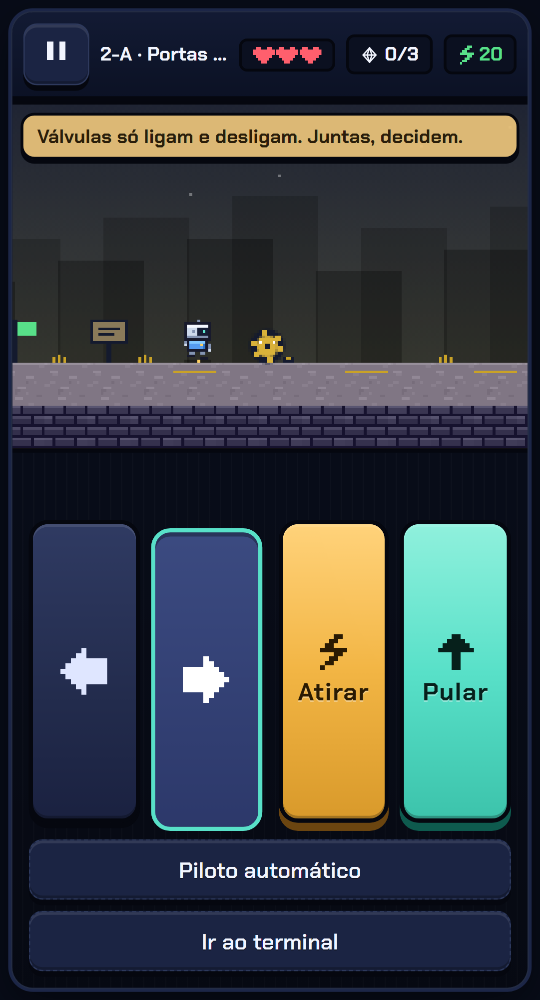
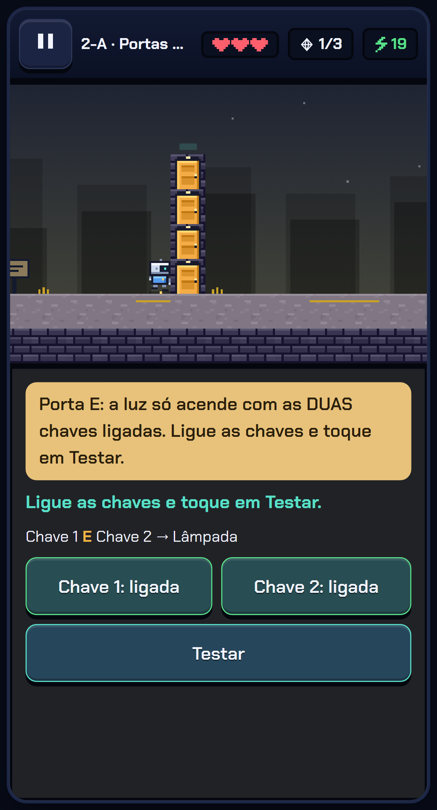
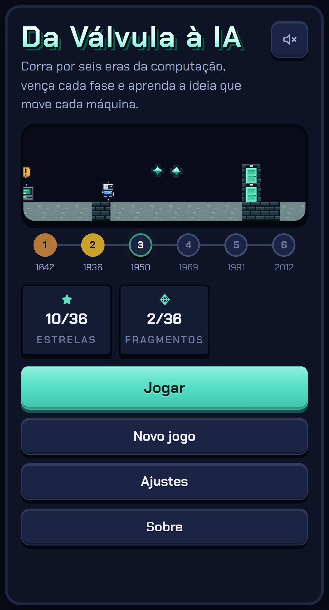
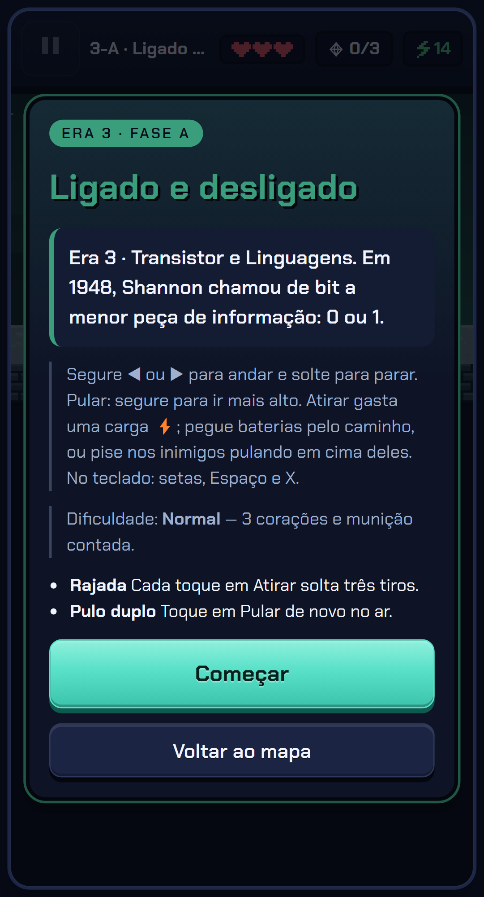
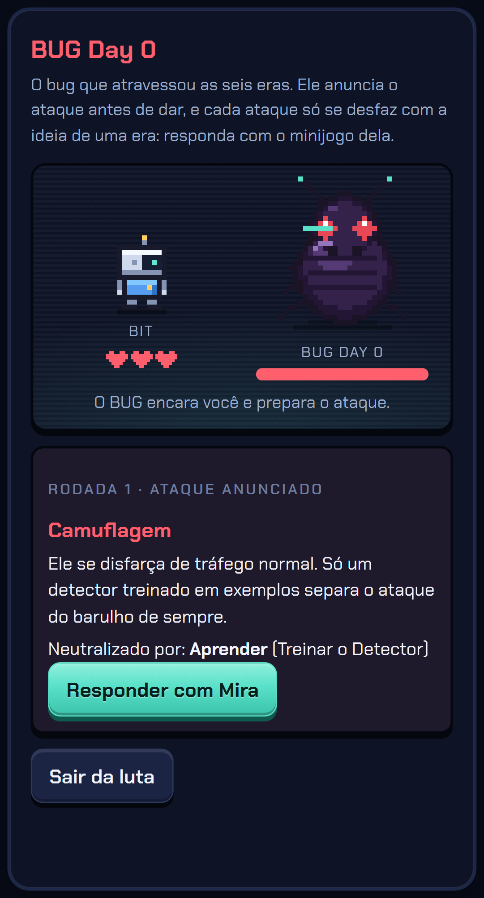

# Da Válvula à IA

**Jogo educacional de fases, em pixel art, sobre a história da computação**, jogado no navegador.

Você controla o **Bit**, um robô pequeno, e corre por seis eras num mapa de fases. Cada fase
ensina a ideia da sua era jogando — o padrão que se repete do tear, as portas lógicas, os bits,
as rotas da rede, a cifra, o aprendizado por exemplos — e termina num terminal com o
**minijogo** daquela ideia. No fim do mapa espera o **BUG Day 0**.

[](https://github.com/SudoMaster7/history-computer/actions/workflows/ci.yml)


Feito como TCC. Mobile-first: celulares de entrada em modo retrato, **100% jogável por toque
simples e botões de segurar, sem arrastar**.

<table>
  <tr>
    <td width="33%"></td>
    <td width="33%"></td>
    <td width="33%"></td>
  </tr>
  <tr>
    <td align="center"><sub>O mapa da jornada</sub></td>
    <td align="center"><sub>A fase: Pular e Atirar</sub></td>
    <td align="center"><sub>Portão de conceito (Era 2)</sub></td>
  </tr>
  <tr>
    <td width="33%"></td>
    <td width="33%"></td>
    <td width="33%"></td>
  </tr>
  <tr>
    <td align="center"><sub>Menu</sub></td>
    <td align="center"><sub>Abertura da fase</sub></td>
    <td align="center"><sub>O BUG Day 0</sub></td>
  </tr>
</table>

---

## Como se joga

1. **Escolha a fase no mapa.** São seis ilhas, uma por era, com duas fases cada (A e B). Tocar
   numa fase aberta faz o Bit saltar até ela. A fase seguinte abre quando a anterior termina.
2. **Jogue como Mega Man ou Mario.** Segure **◀** ou **▶** para andar e solte para parar.
   **Pular** vence buraco, parede e espinho (segurando, vai mais alto); **Atirar** derruba
   engrenagens, faíscas, torres, saltadores, blindados (dois tiros), pingos que caem do alto e
   vírus. Dá para segurar a direção com um dedo e pular com outro. Cada tiro gasta uma carga
   ⚡: pegue as baterias pelo caminho, ou pise nos inimigos pulando em cima deles. Cair ou levar golpe tira
   um coração e volta ao último checkpoint; sem coração, a fase recomeça — nada salvo se perde.
   O terreno muda: degraus, pedras sobre buracos largos, chão rachado que cai, molas que levam a
   plataformas no alto. As placas aparecem num balão, sem parar o jogo.
   Escolha a **dificuldade** no mapa: Fácil (5 corações), Normal (3) ou Difícil (2 e pouca
   munição).
3. **Pense no portão.** Cada fase tem portões de conceito, e o Bit para sozinho diante deles. O
   portão só abre usando a ideia da era: continuar o padrão do tecido, armar as chaves da porta
   E/OU/NÃO, ligar os bits que somam o número, escolher a rota de menor atraso, decifrar a letra
   pela chave, derrubar só os vírus comparando exemplos. É o ensaio do minijogo.
4. **Recolha os fragmentos de memória** (os losangos que brilham): as curiosidades deles aparecem
   no fim da fase. Alguns estão no alto e pedem o pulo na hora certa.
5. **No terminal do fim, jogue o minijogo.** Você já sabe do que ele trata e como se joga. "O que
   é isto?" conta qual máquina de verdade ele imita, e "Dica" libera ajudas uma a uma. As
   estrelas do minijogo são as estrelas da fase.
6. **Feche a era e ganhe a habilidade dela**, como em Mega Man X — sem botão novo: Rajada, Pulo
   duplo, Tiro perfurante, Salto de nó, Escudo e Mira.
7. **No fim do mapa, enfrente o BUG Day 0.** Ele anuncia o ataque, e cada ataque só se desfaz
   com a ideia de uma era: responder é jogar a versão curta daquele minijogo. Respondeu bem, o
   BUG leva o golpe (mais forte quanto mais estrelas na era); respondeu mal, o Bit perde um
   coração.

| Era                     | Período   | Ideia     | Portão da fase                  | Minijogo            | Habilidade      |
| ----------------------- | --------- | --------- | ------------------------------- | ------------------- | --------------- |
| Mecânica                | 1642–1843 | Repetir   | continuar o padrão do tecido    | Tear de Engrenagens | Rajada          |
| Válvulas e Lógica       | 1936–1950 | Decidir   | chaves e portas E/OU/NÃO        | Circuitos Lógicos   | Pulo duplo      |
| Transistor e Linguagens | 1950–1970 | Codificar | bits 8/4/2/1 que somam o número | Mesa de Bits        | Tiro perfurante |
| Redes                   | 1969–1991 | Conectar  | a rota de menor atraso          | Rota dos Pacotes    | Salto de nó     |
| Web, Nuvem e Segurança  | 1991–2010 | Proteger  | decifrar a letra pela chave     | Cofre Criptográfico | Escudo          |
| Inteligência Artificial | 2012–hoje | Aprender  | só os vírus, pelos exemplos     | Treinar o Detector  | Mira            |

---

## Estado do projeto

Nada aqui é promessa: só está marcado como pronto o que já roda.

As **12 fases** e o **BUG Day 0** fecham a campanha inteira. Cada fase tem os portões da sua era,
três fragmentos e termina no minijogo dela; fechar a era dá a habilidade.

O que o contrato garante, e não é promessa: `tests/contract/progression.test.ts` zera a
campanha inteira pelas funções puras — um robô de referência **corre cada fase** até o terminal
(sem habilidade nenhuma, com as que o jogador teria e com as seis), abre cada portão sem erro,
resolve o minijogo e vence o chefão. Se alguma fase deixar de fechar, ele diz qual.

Os testes de ponta a ponta rodam em Pixel 5, iPhone 12 e desktop, e um deles **joga a fase 1-A
inteira pelo navegador**: o piloto automático do modo desenvolvedor pula e atira, e o teste
resolve o portão-tear tocando no painel, como um jogador.

**Som e música** são sintetizados na hora, sem nenhum arquivo de áudio. Começam desligados —
liga no botão do canto do menu; em Ajustes dá para ficar só com os efeitos.

Ainda falta: o **ranking no Supabase** e tudo o que depende dele. O desenho do ranking, do
duelo assíncrono e da batalha entre jogadores está em
[`docs/MULTIPLAYER.md`](docs/MULTIPLAYER.md) — é proposta, nada ali está implementado.
Também falta conferir em fonte primária as placas das fases e as curiosidades dos fragmentos
(ver `ASSETS.md`), e alguém do grupo ouvir e afinar as faixas de música, que foram escritas em
código. O chefão é uma luta de rodadas com os micro-minijogos; virar uma arena de plataforma é
um próximo passo possível (D77).

---

## Rodar

Precisa de **Node 22+**.

```bash
git clone https://github.com/SudoMaster7/history-computer.git
cd history-computer
npm install
npm run dev
```

Abre em `http://localhost:5173`. Para ver o jogo como ele foi pensado, use o modo celular do
navegador, em retrato.

> **Para testar uma fase sem jogar as anteriores:** Menu > **Ajustes** > **Modo
> desenvolvedor**. Ele abre todas as fases e o BUG Day 0, e dentro da fase mostra **Piloto
> automático** (o robô pula e atira por você) e **Ir ao terminal** (pula a ação). No chefão as
> habilidades valem no nível máximo. Não concede progresso: o save continua exatamente como
> estava (ver [D53](DECISIONS.md) e [D79](DECISIONS.md)).

<details>
<summary>Todos os comandos</summary>

| Comando                         | O que faz                                                   |
| ------------------------------- | ----------------------------------------------------------- |
| `npm run dev`                   | servidor de desenvolvimento                                 |
| `npm run build`                 | checagem de tipos + build de produção                       |
| `npm run test`                  | testes de unidade e de contrato (Vitest)                    |
| `npm run test:contract`         | só os testes de contrato (rápido, serve durante o trabalho) |
| `npm run test:e2e`              | Playwright em Pixel 5, iPhone 12 e desktop                  |
| `npm run ci`                    | tudo que a CI roda                                          |
| `npm run change -- "o que fez"` | cria a nota da sua iteração                                 |
| `npm run sprites`               | regenera a pixel art                                        |
| `npm run stages`                | regenera as 12 fases (planta e textos)                      |

Para o Playwright, rode antes `npx playwright install chromium webkit`.

</details>

---

## Publicar na Vercel

O repositório já vem configurado: a raiz do repositório **é** a raiz do projeto,
então não há "Root Directory" para ajustar.

1. Em [vercel.com/new](https://vercel.com/new), importe
   `SudoMaster7/history-computer`.
2. A Vercel detecta Vite sozinha. **Não há variável de ambiente para
   configurar** — o jogo roda inteiro no navegador, sem servidor e sem chave.
3. Deploy.

Cada push na `main` publica em produção, e cada pull request ganha uma URL de
prévia.

O [`vercel.json`](vercel.json) cuida de três coisas que quebram um PWA se
ficarem no padrão:

| Caminho                                       | Cache                      | Por que                                                                                 |
| --------------------------------------------- | -------------------------- | --------------------------------------------------------------------------------------- |
| `sw.js`, `manifest.webmanifest`, `index.html` | sem cache, revalida sempre | service worker em cache prende o jogador numa versão velha, e nenhuma atualização chega |
| `/assets/*`                                   | 1 ano, imutável            | tem hash no nome: conteúdo novo, nome novo                                              |
| `/sprites/*`, `/fonts/*`                      | 30 dias                    | não tem hash no nome; quem versiona esses arquivos é o service worker                   |

Também traz o redirecionamento de rota única (qualquer URL cai no
`index.html`) e três cabeçalhos de segurança básicos.

> **Para testar o que vai ao ar:** `npm run build && npm run preview`. Isso
> serve exatamente o `dist/` que a Vercel publica — e é contra ele que os 120
> testes de ponta a ponta rodam.

---

## Como funciona por dentro

**React + TypeScript + Vite**, PWA instalável. A fase é **canvas 2D com pixel art 16×16** —
sem WebGL, sem motor de física, sem biblioteca de jogo.

### A regra que sustenta tudo

> `src/core/` e os `logic.ts` dos minijogos **não importam React, canvas, DOM nem rede**.
> Toda regra de jogo é função pura e determinística. Aleatoriedade só por `createRng(seed)`.

Por isso a lógica inteira do jogo é testável sem navegador, e a mesma seed sempre produz o
mesmo resultado. A regra é cobrada pelo ESLint **e** por um teste que lê o código-fonte — então
afrouxar o lint não faz o problema sumir.

### Mapa do repositório

```
src/
  core/         regra pura: stage (fase), gadgets (portões), campaign (mapa), progress,
                boss, powers, scoring, rng, registry
  minigames/    <era>/logic.ts (puro) + Screen.tsx + index.ts + logic.test.ts
  ui/           MainMenu, OverworldScreen (mapa), StageScreen + stageArt + GatePanel (fase),
                MissionRunner, BossScreen
  fx/           som e música sintetizados (Web Audio) e efeitos de tela
  store/        Zustand com persistência em localStorage (save versão 2)
  data/         JSON do conteúdo + módulos que o tipam
tools/          geradores de conteúdo e de arte, e os scripts das notas
tests/contract/ o que não pode quebrar
tests/e2e/      Playwright
docs/changes/   uma nota por iteração, com o motivo da mudança
```

Duas regras de organização que valem sempre:

- **Todo número de balanceamento mora em [`src/core/constants.ts`](src/core/constants.ts).**
  Para calibrar o jogo, só esse arquivo muda.
- **Todo texto visível ao jogador mora em `src/data/*.pt-BR.json`.** Identificador de código em
  inglês, texto de jogador em português.

### Como uma fase é desenhada

As fases são montadas por trechos em [`tools/make-stages.py`](tools/make-stages.py)
(`npm run stages`), que escreve `src/data/stages.json` (a planta) e `src/data/stages.pt-BR.json`
(título, abertura, placas e resumo). A planta é vista de lado, uma string por linha:

```
.  ar         #  chão        =  bloco       ^  espinho
S  partida    G  terminal    C  checkpoint  F  fragmento
i  placa      D  portão      w f t  inimigos             p  programa (Era 6)
```

`parseStage` traduz para a fase e `stepRun` avança um passo de 1/60 s — a mesma sequência de
toques dá sempre o mesmo resultado. `validateStage` recusa fase sem chão na partida, portão sem
dispositivo ou sem checkpoint antes, e o robô de referência (`referenceRun`) prova que ela
fecha. **Fase quebrada não entra no jogo.**

### A pixel art é gerada por código

Não há asset baixado: [`tools/make-sprites.mjs`](tools/make-sprites.mjs) desenha os tilesets
das seis eras, o Bit e o BUG, e escreve os PNG usando só o `zlib` do Node. A fase reaproveita o
Bit de perfil e o chão, a porta e o terminal do tileset da era; inimigos, espinhos e programas
são pintados em código, em `src/ui/stageArt.ts`.

---

## Mexendo no projeto

Leia **[CONTRIBUINDO.md](CONTRIBUINDO.md)** antes da primeira mudança. O essencial:

```bash
npm run ci                      # lint, tipos, notas, testes com cobertura, build
npm run test:e2e                # Playwright nos 3 dispositivos
npm run change -- "o que fez"   # a nota da sua iteração — obrigatória
```

`tests/contract/` trava o que não pode quebrar:

| Arquivo                | O que trava                                     |
| ---------------------- | ----------------------------------------------- |
| `architecture.test.ts` | o núcleo é puro e determinístico                |
| `api-surface.test.ts`  | os nomes exportados pelo `core/`                |
| `content.test.ts`      | os dados fecham entre si, e a arte existe       |
| `progression.test.ts`  | **o jogo é zerável, sem travar em nenhuma era** |

**Nunca deixe um contrato verde apagando o que ele exigia.** Se o contrato está errado, ele
muda — mas na mesma iteração, com o motivo escrito na nota.

As mesmas regras valem para agentes de IA e estão em [CLAUDE.md](CLAUDE.md), que eles leem
automaticamente.

---

## Documentos

| Arquivo                            | O que tem                                                 |
| ---------------------------------- | --------------------------------------------------------- |
| [CONTRIBUINDO.md](CONTRIBUINDO.md) | o passo a passo de uma iteração e o roteiro de revisão    |
| [DECISIONS.md](DECISIONS.md)       | toda escolha de projeto, numerada, com o motivo           |
| [docs/changes/](docs/changes/)     | uma nota por iteração: o que mudou, por quê, o que quebra |
| [ASSETS.md](ASSETS.md)             | licenças da arte, da fonte e do conteúdo                  |
| [CLAUDE.md](CLAUDE.md)             | as regras para agentes de IA                              |

> **Atenção:** `docs/fases/` guarda o briefing original (F1 a F5). Ele descreve um RPG com hub
> 3D e combate por turnos, que **não é mais o jogo** — a direção mudou duas vezes, e as duas
> estão registradas em `DECISIONS.md` (D11–D16 e D17–D23). Leia o briefing como história do
> projeto, não como especificação.

---

## Licenças

| O quê                                       | Licença                                      |
| ------------------------------------------- | -------------------------------------------- |
| Código                                      | [MIT](LICENSE)                               |
| Conteúdo educacional (placas, curiosidades) | CC BY 4.0                                    |
| Pixel art                                   | autoral, gerada por `tools/make-sprites.mjs` |
| Fonte Chakra Petch                          | SIL Open Font License 1.1                    |

O conteúdo histórico das placas, dos minijogos e dos fragmentos foi escrito para este projeto a partir de
conhecimento consolidado, mas **ainda não passou por conferência em fonte primária**. Datas e
números (como as 18 mil válvulas do ENIAC) precisam ser checados antes de congelar o escopo —
está registrado em [ASSETS.md](ASSETS.md).
